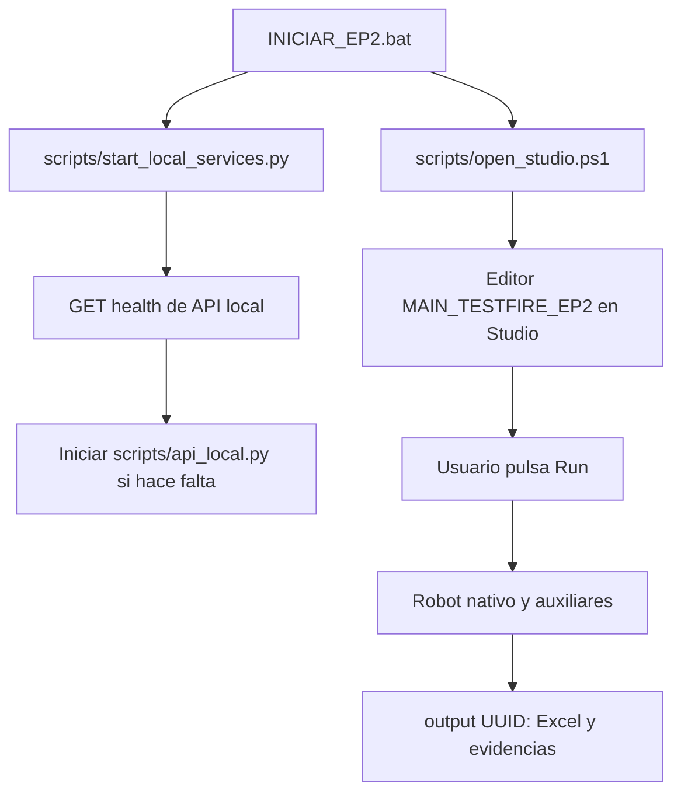

# Guia completa del proyecto TestFire EP2

Entrega actualizada para el 20/10/2026: [indice de entregables](docs/ENTREGABLES_20261020.md). El ZIP vigente es `entrega/TestFire_EP2_20261020.zip`; los nombres con fecha 20261018 corresponden al historial.

Segunda PC comprobada el 19 de octubre de 2026: [validacion y evidencias](docs/VALIDACION_SEGUNDA_PC.md). El resumen de DESKTOP-OFQ9QLA coincide con el almacen del host y GET devuelve HTTP 200. MySQL sigue pendiente; las referencias a SEGUNDA_PC pendiente en corridas y secciones anteriores son historicas.

Correccion para el Python interno de Rocketbot: [dependencias portables](docs/CORRECCION_DEPENDENCIAS_ROCKETBOT.md). `dotenv` y `pytz` se distribuyen en `auxiliaries/_vendor`, con sus licencias, y se habilitan desde `auxiliaries/__init__.py`. Reiniciar Rocketbot despues de actualizar esos archivos.

Actualizacion de red, 19 de octubre de 2026: [configuracion de ambas PC](docs/CONFIGURACION_SEGUNDA_PC.md). Esta PC actua como servidor de resumenes y maestro Excel; ambas ejecutan Rocketbot. El cliente usa `API_ROLE=client`. La API y su regla de firewall estan configuradas en el host; falta comprobar la ejecucion fisica desde el otro equipo. MySQL sigue pendiente. Las secciones siguientes describen tambien el modo local original.

Revision: 18 de octubre de 2026. Esta guia explica que ejecutar, donde esta cada responsabilidad, como circulan los datos y como mantener el proyecto. Las rutas se expresan respecto de la carpeta que contiene este archivo.

Revision funcional posterior: [docs/REVISION_FUNCIONAL.md](docs/REVISION_FUNCIONAL.md). Incluye correcciones de cierre SQLite, tratamiento de errores al finalizar y verificacion estricta de ejecuciones de Studio, con 48 pruebas Python y 6 pruebas Node. Las cifras de la corrida original citadas abajo se conservan como referencia historica.

## 1. Que hace el proyecto y que esta comprobado

El robot consulta el sitio publico de demostracion TestFire, inicia sesion, abre la vista de transacciones, extrae una tabla mediante XPath y valida sus filas. Despues lee un Excel externo, compara ambas fuentes, registra un resumen en una API local y genera un Excel con resultados y auditoria.

Rocketbot dirige la navegacion, los ciclos y las decisiones. Los modulos Python realizan operaciones puntuales; el robot principal no ejecuta el antiguo programa Selenium de la EP1.

La corrida de referencia es `076648bf-3612-42b9-b915-d14cd7982d57`: 100 filas leidas, 96 aceptadas y 4 rechazadas porque sus importes excedian DECIMAL(18,2). La conciliacion produjo 100 SOLO_MASTER y 96 SOLO_WEB. El sitio compartido cambio entre la captura del maestro y la ejecucion; esos resultados no significan que el robot deba inventar coincidencias. La duracion registrada fue 206,514 segundos, aproximadamente 3 minutos y 27 segundos.

Las 45 pruebas automatizadas, el export oficial y la ejecucion web tienen evidencia guardada. Los resultados de una nueva ejecucion pueden cambiar porque TestFire es un sitio compartido.

**Limites vigentes:** MySQL esta pendiente por indicacion del usuario; falta la prueba en otra PC y la aceptacion docente del grabador DOM alternativo. La vista consultada muestra los 100 movimientos recientes, no todo el historial ni un filtro por cuenta en origen. El maestro actual es un snapshot previo, no una contabilidad independiente. El estado tecnico global se conserva como PARCIAL; `web_excel_api_complete=true` identifica el alcance funcional comprobado.

## 2. Que archivo abrir segun lo que quieras hacer

| Necesidad | Archivo o lugar |
|---|---|
| Ejecutar el robot real | [INICIAR_EP2.bat](INICIAR_EP2.bat); despues Run en Studio |
| Entender el proyecto completo | Este archivo |
| Ver instrucciones resumidas | [README.md](README.md) |
| Configurar cuenta, token, rutas y periodo | `.env`, en la raiz; no compartir sus valores |
| Ver la plantilla de configuracion | [.env.example](.env.example) |
| Editar visualmente el robot | `rocketbot/MAIN_TESTFIRE_EP2/robot.db`, abierto en Rocketbot Studio |
| Abrir el export oficial editable | `rocketbot/MAIN_TESTFIRE_EP2/EXPORT_TESTFIRE_EP2.db`, conservando esa ubicacion relativa |
| Cambiar la fuente externa | `data/master_snapshot_testfire.xlsx` o `MASTER_EXCEL_PATH` en `.env` |
| Ver el resultado de una corrida | `output/<UUID>/Reporte_TestFire_...xlsx` y `execution.json` |
| Preparar la exposicion | `docs/GUION_PRESENTACION.md` y `docs/entrega/Presentacion_EP2.pptx` |
| Leer el informe | `docs/entrega/Informe_Tecnico_EP2.pdf` |
| Entregar una copia portable del proyecto | `entrega/TestFire_EP2_20261018.zip` |
| Revisar que se elimino durante la limpieza | [docs/LIMPIEZA_ARCHIVOS.md](docs/LIMPIEZA_ARCHIVOS.md) |

## 3. Como iniciar la ejecucion en este equipo

1. Mantener la estructura de carpetas completa. No mover solamente `robot.db` al escritorio: sus comandos localizan los auxiliares a partir de la carpeta del proyecto nativo.
2. Revisar `.env` local. Deben existir la cuenta de demostracion, el token de API, el maestro y un periodo compatible con el maestro.
3. Abrir `INICIAR_EP2.bat` desde el Explorador. Desde PowerShell, situado en esta carpeta, tambien puedes ejecutar:

```powershell
.\INICIAR_EP2.bat
```

4. El lanzador comprueba la API local. Si no esta activa con la configuracion esperada, intenta iniciarla en segundo plano.
5. Se abre Rocketbot Studio. Si estaba cerrado, puede mostrar la pregunta opcional de actualizacion de drivers. Responderla, esperar a que Studio este disponible y volver a abrir el lanzador si aun no muestra el editor del robot.
6. Comprobar que el nombre del robot sea `MAIN_TESTFIRE_EP2` y pulsar **Run**. Mantener la pagina de Studio abierta mientras trabaja; la pagina coordina el envio de comandos al runtime.
7. Esperar al cierre. Buscar la carpeta nueva en `output/`, abrir `execution.json` y el Excel de esa misma carpeta. No confundir una corrida anterior con la que se acaba de lanzar.

El acceso al sitio usa HTTP solo con la cuenta publica de demostracion porque HTTPS fallo por certificado durante la validacion. El proyecto no desactiva globalmente TLS. No introducir cuentas bancarias reales.

### Que ocurre al abrir el lanzador



`INICIAR_EP2.bat` utiliza `.venv-ep2` para iniciar la API. **El Python de la API y el Python integrado de Rocketbot son entornos diferentes.** Instalar una dependencia en `.venv-ep2` no la instala automaticamente dentro de Rocketbot.

El lanzador que esta dentro de `rocketbot/MAIN_TESTFIRE_EP2/` abre el robot en Studio, pero no prepara por si mismo la API. Para la demostracion habitual conviene usar el lanzador de la raiz.

## 4. Estructura de carpetas

| Carpeta | Responsabilidad | Por que se conserva |
|---|---|---|
| `auxiliaries/` | Configuracion, validacion, conciliacion, Excel, auditoria, HTTP y adaptadores | Codigo utilizado por los comandos Python de Rocketbot |
| `api/` | Servidor HTTP y almacenamiento de acuses | Servicio consumido por el robot |
| `rocketbot/` | Proyecto nativo, export y explicaciones de montaje | Implementacion editable en la herramienta RPA |
| `scripts/` | Lanzadores, generadores, comprobaciones y herramientas de mantenimiento | Permiten ejecutar y reproducir la entrega |
| `data/` | Maestro real de demostracion, plantilla vacia y datos sinteticos | Entradas del flujo y de pruebas |
| `database/` | Esquema, referencias y consultas MySQL | Ampliacion preparada, pendiente de validacion real |
| `recorder/` | Grabador DOM, captura original y comandos derivados | Evidencia de acciones grabadas y su conversion a Rocketbot |
| `tests/` | Pruebas automatizadas | Verifican contratos, errores, persistencia y transformaciones |
| `config/` | Inventario de dependencias y notas del entorno | Distingue los paquetes externos de los del runtime Rocketbot |
| `docs/` | Informe fuente, guion, matriz, procedimientos y evidencia | Documentacion tecnica y academica |
| `docs/entrega/` | PDF y PPTX vigentes | Documentos listos para revisar y presentar |
| `docs/diagramas/` | Fuentes Mermaid y versiones SVG, PNG y PDF | Fuentes editables y representaciones para documentos |
| `docs/evidencias/` | Capturas, respuestas, resultados de pruebas y comprobaciones | Sustento de las afirmaciones del informe |
| `docs/fuentes_extraidas/` | Texto extraido de documentos originales | Trazabilidad de requisitos; no se incluye en el ZIP |
| `output/` | Resultados por ejecucion, acuses API y logs locales | Datos operativos y evidencia; no es una carpeta de cache |
| `entrega/` | ZIP vigente y acta de integridad | Paquete para copiar o entregar |
| `resultados/`, `evidencias/` | Artefactos originales EP1 | No confundirlos con `output/` y `docs/evidencias/` de EP2 |
| `.venv/` | Entorno anterior | Se conserva junto a la EP1 |
| `.venv-ep2/` | Entorno externo EP2 | Ejecuta API, pruebas y generadores; no viaja en el ZIP |
| `.vscode/` | Configuracion del IDE | Configuracion local del usuario |
| `.limpieza_respaldo/` | Archivos obsoletos y caches apartados de forma reversible | Respaldo excluido del ZIP; conserva la estructura anterior para recuperar un archivo si hace falta |

Los archivos `prueba.py`, `PDD_TestFire.docx`, `Informe_Tecnico_TestFire.docx`, `Presentacion_TestFire.pptx`, `INSTRUCCIONES_EJECUCION.txt` y `requirements.txt` pertenecen a la EP1. Se mantienen como antecedente. El flujo EP2 no los llama durante una ejecucion normal.

## 5. Configuracion: que hace cada variable

`auxiliaries/config.py` carga primero `.env.example`, despues `.env` y finalmente variables del entorno que coincidan con las claves conocidas. Una variable del sistema puede, por tanto, sobrescribir el valor de `.env`. El modulo convierte puertos y limites a enteros, comprueba rutas y calcula un hash de configuracion sin los secretos.

| Variable | Funcion y uso actual |
|---|---|
| `TESTFIRE_URL` | Direccion base del sitio. El inicio agrega `/login.jsp` |
| `TESTFIRE_USER`, `TESTFIRE_PASSWORD` | Cuenta de demostracion; se cargan en variables de Studio, sin escribir los valores en la guia |
| `MASTER_EXCEL_PATH` | Archivo externo que se leera; en esta demostracion: `data/master_snapshot_testfire.xlsx` |
| `OUTPUT_ROOT` | Carpeta de resultados dentro del proyecto; normalmente `output` |
| `PERIOD_START`, `PERIOD_END` | Periodo aceptado para validar filas y comprobar metadata del maestro; formato `YYYY-MM-DD` |
| `ALLOW_SYNTHETIC_MASTER` | Permite un maestro marcado sintetico solo cuando se configura expresamente; el snapshot web usa `false` |
| `API_BASE_URL` | En el lanzador local debe ser `http://127.0.0.1:18081` |
| `API_TOKEN` | Token Bearer privado compartido entre robot y API; no enviarlo en el chat ni incluirlo en el paquete |
| `API_BIND_HOST`, `API_PORT` | Configuracion del servidor general `api/app.py`; el modo `scripts/api_local.py` fija loopback y puerto 18081 |
| `HTTP_TIMEOUT_SECONDS` | Limite por solicitud HTTP del cliente auxiliar |
| `WEB_TIMEOUT_SECONDS` | Configuracion prevista para web; los comandos nativos actuales tienen 30 segundos escritos en el constructor |
| `MAX_RETRIES` | Configuracion general validada; el While nativo actual fija hasta tres intentos POST. Cambiar solo esta variable no reconstruye ese While |
| `DB_HOST`, `DB_PORT`, `DB_NAME`, `DB_USER`, `DB_PASSWORD` | Conexion MySQL para el modo ampliado; el MAIN web actual no la abre |
| `DISPLAY_TIMEZONE` | Zona usada para los nombres de reporte; los instantes de auditoria se guardan en UTC |
| `ROBOT_VERSION` | Etiqueta de version incluida en cada auditoria |

`PROJECT_ROOT` se calcula al iniciar y no se debe llenar con una ruta personal en el export. En los comandos nativos actuales se obtiene desde `%project_path%`, subiendo dos niveles desde `rocketbot/MAIN_TESTFIRE_EP2/`. Por eso debe conservarse esa ubicacion relativa.

La plantilla `.env.example` sirve a mas de un modo y no replica necesariamente la configuracion de la demo local. Para preparar otra copia hay que ajustar la URL, el maestro y la API al modo elegido; copiar la plantilla sin completarla no basta.

## 6. Recorrido interno del robot, paso a paso

### 6.1 Inicio y memoria de la ejecucion

`MAIN_TESTFIRE_EP2` carga la raiz, agrega el proyecto a la ruta de importacion de Python y llama a `auxiliaries/studio_web.py:initialize`. Esta funcion lee configuracion, exige credenciales web y token, crea un objeto `Audit` y guarda la sesion en `bridge._sessions`, identificada por UUID.

La sesion contiene configuracion, auditoria, filas validas/rechazadas, pares conciliados, llamadas HTTP y banderas de estado. Es memoria del proceso de Rocketbot, no una tabla SQL. Si se reinicia Studio a mitad de una corrida, esa memoria se pierde: corresponde iniciar otra ejecucion y revisar la corrida interrumpida.

### 6.2 Login: subrobot WEB_LOGIN

El MAIN invoca al hijo mediante el comando nativo `execRocketBotDB`. `WEB_LOGIN` abre Chrome, espera el campo de usuario, completa usuario y clave, pulsa Login y espera el enlace de transacciones. Los hijos heredan las variables declaradas por el padre.

Las acciones de entrada y click proceden del export del grabador DOM. Las esperas por elementos son ajustes agregados para que la secuencia no dependa solamente de pausas fijas.

### 6.3 Extraccion: subrobot EXTRACT_TRANSACTIONS

El hijo pulsa el enlace de transacciones, espera la tabla y ejecuta `gettable_extend` —Extraer tabla— con XPath. El resultado queda en `tabla_web`.

`studio_web.rows` interpreta ese resultado y comprueba las cabeceras `Transaction ID`, `Transaction Time`, `Account ID`, `Action`, `Amount`. Descarta filas completamente vacias de maquetacion, pero falla si una fila no vacia tiene estructura distinta. Conserva la tabla recibida en `dom_table.json` y las filas transformadas en `web_rows_raw.json`.

No hay un servidor local fingiendo ser TestFire durante este flujo. `dom_transacciones.html` es una captura guardada para documentacion; MAIN no la usa como pagina ni como reemplazo del sitio.

### 6.4 Validacion de filas

Un **For nativo** recorre `filas_web`. Cada vuelta llama a `bridge.validate`, que utiliza `validation.validate_row`. Un **IF nativo** decide si agrega la fila a validas o a rechazadas.

La validacion comprueba cuenta, descripcion, indice, fecha y dinero. Para esta vista usa `testfire_minute`: `YYYY-MM-DD HH:MM`. Regex comprueba la forma; `datetime.strptime` detecta fechas imposibles; `Decimal` interpreta importes. Tambien se rechazan importes fuera del rango de DECIMAL(18,2) y fechas fuera del periodo configurado. El valor original se conserva junto con el normalizado.

### 6.5 Lectura del Excel externo

`studio_web.read_reference` obtiene las cuentas presentes en el maestro y en las filas validas, prepara reglas locales habilitadas con tolerancia `0.00` y origen `EXCEL-SNAPSHOT`, y llama a `bridge.read_excel`.

`excel.read_master` exige las hojas `Master` y `Metadata`, comprueba columnas, version, marca de datos sinteticos y periodo. Valida las filas y devuelve metadata, incluido el hash del archivo. Las reglas de este modo no proceden de MySQL.

### 6.6 Conciliacion

`reconciliation.plan_pairs` construye pares de filas. Cuando hay identificador web, usa cuenta e identificador; si no lo hay, utiliza una clave de valores y preserva las ocurrencias. Para filas emparejadas compara fecha, descripcion normalizada, moneda y diferencia de importe respecto de la tolerancia.

Otro **For nativo** recorre los pares y varios **IF nativos** asignan el estado:

| Estado | Interpretacion |
|---|---|
| `CONCILIADO` | Hay fila en ambas fuentes y no existen diferencias segun las reglas |
| `DISCREPANCIA` | Hay ambas filas, pero difieren campos comparados |
| `SOLO_WEB` | Existe la fila web, sin pareja en el maestro |
| `SOLO_MASTER` | Existe la fila del maestro, sin pareja web |
| `AMBIGUO` | IDs repetidos o multiplicidades impiden una correspondencia clara |

Cambiar IDs o borrar duplicados para conseguir coincidencias destruiria la trazabilidad. La salida debe reflejar las diferencias reales entre las fuentes.

### 6.7 Integracion HTTP

El robot llama a `bridge.http`, que delega una solicitud en `http_client.call_http`. La secuencia es GET de salud, POST de resumen, repeticion del POST y GET del acuse. El While de reintento vive en Studio; el auxiliar no oculta un ciclo de navegacion ni una politica ilimitada de reintentos.

Se guardan solicitud, respuesta, codigo HTTP, duracion y validez. Los headers sensibles se redactan. El robot comprueba que el acuse consultado coincida con el payload enviado.

### 6.8 Reporte, cierre y errores

`bridge.export_excel` llama a `excel.write_report`. La escritura usa un archivo temporal y despues reemplaza el destino; las celdas de texto se fuerzan como texto para evitar interpretar descripciones como formulas.

Try Catch registra fallos y cierra pasos de auditoria abiertos. Otro bloque intenta cerrar el navegador con `killdriver`. `studio_web.finalize` guarda resultados, filas, rechazos y llamadas; cierra el resumen, actualiza el Excel y registra el hash del artefacto.

Para entender un fallo especifico, revisar tambien la respuesta original del comando de Studio. El resumen general del manejador no sustituye ese detalle. Un archivo `native_error.json` indica que se recorrio la rama de error.

## 7. Que hace cada modulo Python

| Archivo | Responsabilidad concreta | Lo usa |
|---|---|---|
| `auxiliaries/config.py` | Cargar `.env`, validar configuracion, resolver rutas y ocultar secretos al presentar configuracion | Robot, API y comprobaciones |
| `auxiliaries/studio_web.py` | Adaptador del MAIN real: inicializar sin MySQL obligatorio, interpretar tabla, leer referencia y cerrar con estado del modo web | Comandos Python del MAIN |
| `auxiliaries/bridge.py` | Fachada de operaciones puntuales y registro de sesiones: validar, agregar filas, generar pares, llamar API, exportar y preparar sincronizacion | MAIN y demo nativa |
| `auxiliaries/validation.py` | Regex, UUID, fechas, importes, descripcion normalizada y validacion de una fila | Web, maestro y pruebas |
| `auxiliaries/reconciliation.py` | Emparejamiento, diferencias, multiplicidad y conteos | Bridge y pruebas; las decisiones del MAIN permanecen en IF nativos |
| `auxiliaries/excel.py` | Crear maestros de ejemplo, leer maestro y generar las cinco hojas del reporte | Robot y demos |
| `auxiliaries/audit.py` | UUID, tiempos UTC/monotonos, redaccion de secretos, JSON/JSONL, outbox y hashes | Operaciones auditadas |
| `auxiliaries/http_client.py` | Una solicitud HTTP con timeout, validacion de contrato y evidencia redactada | Bridge |
| `auxiliaries/database.py` | Repositorio MySQL, consultas parametrizadas, persistencia y replay de outbox | Modo ampliado y herramientas SQL; no la corrida web local |
| `auxiliaries/studio_demo.py` | Sesion sintetica de DEMO_LOCAL_EP2 y conversion de variables entre objetos/JSON/representaciones Python | Demo; MAIN reutiliza el conversor `variable` |
| `auxiliaries/timezones.py` | Adaptar ZoneInfo al runtime; usar pytz cuando la biblioteca integrada no lo ofrece | Fechas del reporte |
| `api/app.py` | Rutas Flask, autenticacion Bearer, validacion del payload; incluye almacenes MySQL y de memoria para pruebas | Servidores API y tests |
| `api/local_store.py` | Almacen SQLite explicito para acuses locales persistentes; transacciones y clave primaria | API local real de esta demo |
| `__init__.py` de los paquetes | Identificar paquetes Python; no son lanzadores | Sistema de importacion |

## 8. API local: rutas, datos y persistencia

`scripts/api_local.py` crea la aplicacion Flask con `SQLiteReceiptStore` y escucha en `127.0.0.1:18081`. El archivo de almacenamiento es `output/api_local/receipts.db`. Esa base contiene acuses; **no es el proyecto nativo Rocketbot ni la base MySQL testfire_rpa**.

| Ruta | Resultado esperado |
|---|---|
| `GET /health` | 200 con estado de salud y `storage=sqlite-local` |
| `POST /executions` | 201 si registra un UUID nuevo; 200 si el mismo UUID tiene el mismo contenido |
| `GET /executions/<UUID>` | 200 y el resumen persistido; 404 si no existe |

Un POST con el mismo UUID y contenido distinto responde 409; token incorrecto produce 401; payload invalido, 400; almacenamiento indisponible puede producir 503. El POST registra conteos y duracion hasta el envio, no cada movimiento. `estado_proceso=CONCILIACION_COMPLETADA` expresa el punto del flujo anterior al cierre, no el estado global final de toda la ampliacion.

Para iniciar la API local sola, desde la raiz:

```powershell
.\.venv-ep2\Scripts\python.exe -m scripts.api_local
```

Si ya esta corriendo, no iniciar otra instancia sobre el mismo puerto. `scripts/start_local_services.py` es la alternativa que primero comprueba su salud. Un servidor iniciado en consola puede detenerse con Ctrl+C; cerrar la pagina de Studio no detiene automaticamente la API iniciada en segundo plano.

### Tres modos que no se deben confundir

| Modo | Entrada | Almacenamiento API | Uso |
|---|---|---|---|
| MAIN web actual | Sitio real + snapshot Excel previo | SQLite local persistente, puerto 18081 | Demostracion funcional EP2 |
| DEMO_LOCAL_EP2 | `data/filas_demo.json` + maestro sintetico | Memoria de prueba, puerto 18080 | Ejercitar controles sin depender del sitio |
| Ampliacion MySQL | Configuracion SQL y referencias preparadas | MySQL en `api/app.py` por defecto | Pendiente de credenciales, montaje/validacion real y otra PC |

Completar `DB_PASSWORD` no cambia automaticamente el MAIN al modo MySQL. Se necesita incorporar o activar las operaciones de repositorio y sincronizacion en el flujo, configurar las reglas y probar el servicio correspondiente.

## 9. Entradas y salidas: como leerlas

### Archivos de entrada

| Archivo | Contenido |
|---|---|
| `data/master_snapshot_testfire.xlsx` | Referencia externa actual: captura previa del sitio con version y periodo |
| `data/conciliacion_master.xlsx` | Maestro sintetico para las demos; no presentarlo como datos reales |
| `data/filas_demo.json` | Filas sinteticas que ejercitan validacion y clasificaciones |
| `data/plantilla_master_real.xlsx` | Plantilla que requiere completar filas y metadata antes de usarla |

La hoja `Master` exige estas columnas, en este orden: `account`, `date_raw`, `description`, `amount_raw`, `web_id`, `currency`. `Metadata` contiene pares clave/valor como `version`, `synthetic`, `period_start` y `period_end`. Los periodos deben coincidir con `.env`. Una plantilla con version `COMPLETAR` no es una referencia lista para ejecutar.

### Carpeta de una ejecucion web

| Archivo o subcarpeta | Para que sirve |
|---|---|
| `execution.json` | UUID, equipo, fechas, duracion, estado, conteos y pendientes; empezar por aqui |
| `dom_table.json` | Tabla recibida desde el comando nativo, antes de convertirla a filas del contrato |
| `web_rows_raw.json` | Filas extraidas con valores originales y origen |
| `valid.json` | Filas aceptadas y normalizadas |
| `rejected.json` | Filas rechazadas y causa concreta |
| `master_metadata.json` | Version y huella del maestro utilizado |
| `results.json` | Pares, diferencias y clasificacion final |
| `audit.jsonl` | Un evento de auditoria por linea; cada evento tiene identificador y tiempos |
| `active_steps.json` | Pasos todavia abiertos; al finalizar normalmente debe estar vacio |
| `api_calls.json` | Indice de las solicitudes HTTP de la corrida |
| `http/` | Solicitudes y respuestas individuales, con secretos redactados |
| `outbox/` | Evidencia pendiente de sincronizacion SQL; existencia de archivos no acredita entrega a MySQL |
| `artifacts.json` | Ruta y SHA-256 del reporte producido |
| `Reporte_TestFire_...xlsx` | Documento consolidado para revisar o mostrar |
| `native_error.json`, `browser_close.json` | Diagnostico si se activa una rama de error o advertencia; no aparecen obligatoriamente |

Las demos antiguas pueden usar nombres como `valid_rows.json` y `rejected_rows.json`; el MAIN web actual utiliza los nombres de la tabla anterior.

### Las cinco hojas del Excel final

| Hoja | Que revisar |
|---|---|
| `Movimientos` | Filas validas, campos normalizados y datos originales asociados |
| `Conciliacion` | Estado y diferencias de cada par; una fila web y una del maestro pueden no tener pareja |
| `Rechazados` | Error de validacion y fila original para investigar |
| `Auditoria` | Pasos, intentos, estados y duraciones |
| `Resumen` | Identidad de la ejecucion, resultados y limites de su alcance |

La moneda y el saldo no se inventan si no existen en la tabla. Un reporte generado no significa por si solo exito completo: leer siempre `execution.json` y los rechazos.

## 10. Recorder y archivos nativos

`recorder/dom_recorder.js` escucha eventos reales `change` y `click` del navegador y registra selector, accion y origen. Para los campos de acceso registra los nombres de variables `usuario` y `clave`, no sus valores.

`scripts/record_dom.cjs` abre una sesion dedicada, instala ese listener y conduce el acceso y la navegacion. El listener obtiene los eventos ocurridos; el constructor nativo lee esa captura para derivar los comandos. Es un grabador DOM propio, no el recorder oficial de Rocketbot ni una grabacion de pantalla en video.

| Archivo | Papel |
|---|---|
| `recorder/dom_recording.json` | Export original: cuatro eventos, selectores, URLs e instantes de captura |
| `recorder/native_recorded_commands.json` | Comandos nativos derivados, con variables en lugar de credenciales |
| `docs/evidencias/recorder_dom_tabla.png` | Captura de la sesion de grabacion |
| `docs/evidencias/studio_web_responses.json` | Respuestas de ejecucion nativa que respaldan el replay |
| `docs/EVIDENCIA_RECORDER.md` | Procedimiento, limitaciones y aceptacion docente pendiente |

El intento con DesktopRecorder no capturo acciones. Se conserva esa conclusion documentada; los archivos vacios y el script desechable de ese intento fueron retirados en la limpieza.

`rocketbot/MAIN_TESTFIRE_EP2/robot.db` es la base de trabajo real de Studio. Contiene MAIN, WEB_LOGIN, EXTRACT_TRANSACTIONS y la demo local. `EXPORT_TESTFIRE_EP2.db` es un export oficial editable separado con MAIN y sus dos hijos. No son dos versiones intercambiables para el constructor: `build_native_web.py` usa DEMO_LOCAL_EP2 como base y esa demo no esta en el export reducido.

Las plantillas `docs/evidencias/studio_command_templates.json` y el catalogo `catalogo_comandos_instalado.json` describen formatos y comandos; no son, por si solos, exports importables.

## 11. Scripts: cuales ejecutar y cuales son de mantenimiento

### Lanzadores y operaciones habituales

| Archivo | Responsabilidad |
|---|---|
| `INICIAR_EP2.bat` | Inicio recomendado del modo web real: API local y editor MAIN |
| `ejecutar_ep2.bat` | Entrada al menu de acciones de PowerShell |
| `scripts/run_ep2.ps1` | Acciones `setup`, `test`, `demo`, `api`, `api-demo`, `check`, `replay` |
| `scripts/open_studio.ps1` | Detectar/iniciar Studio y abrir un robot en el proyecto; admite `ROCKETBOT_EXE` si esta instalado en otra ruta |
| `scripts/start_local_services.py` | Verificar token/health de la API local e iniciarla si hace falta |
| `scripts/api_local.py` | Servidor API persistente local de la demostracion actual |
| `scripts/api_demo.py` | Servidor efimero en memoria para pruebas sinteticas |
| `scripts/demo.py` | Prueba de auxiliares con datos sinteticos; no ejecuta Rocketbot ni inicia sesion web |
| `scripts/check_environment.py` | Mostrar configuracion redactada y comprobar MySQL, o reenviar un outbox con `--replay` |

Comandos habituales desde PowerShell en la raiz:

```powershell
# Crear entorno externo e instalar dependencias, si hace falta.
.\ejecutar_ep2.bat -Action setup

# Pruebas automatizadas.
.\ejecutar_ep2.bat -Action test

# Ejercicio sintetico de auxiliares, sin navegador.
.\ejecutar_ep2.bat -Action demo

# API sintetica para DEMO_LOCAL_EP2; mantener esta consola abierta.
.\ejecutar_ep2.bat -Action api-demo
```

`setup` prepara `.venv-ep2` y datos/demo auxiliares; no instala automaticamente Rocketbot ni configura sus dependencias integradas. `-Action api` corresponde al servidor general con MySQL, no al servidor local de `INICIAR_EP2.bat`. `check` puede devolver pendiente si faltan credenciales SQL aunque la demo web local funcione.

### Construccion del robot y captura de evidencia

| Script | Responsabilidad y condicion de uso |
|---|---|
| `build_native_web.py` | Lee la demo y las plantillas, deriva acciones del recorder y guarda MAIN y sus hijos mediante la API de Studio; requiere Studio activo |
| `build_native_demo.py` | Reconstruye la demo sintetica desde formatos reales de Studio; no es el lanzador del flujo web |
| `studio_capture_templates.cjs` | Obtiene plantillas de comandos desde formularios reales de Studio |
| `studio_run_smoke.cjs` | Pese al nombre historico, ejecuta MAIN o la demo en el editor y registra respuestas/captura; requiere Puppeteer y Studio |
| `studio_verification.cjs` | Comprueba que la corrida realmente termino, que no fallaron comandos y que el resumen y UUID corresponden; impide un resultado de prueba falsamente exitoso |
| `record_dom.cjs` | Realiza una nueva captura del grabador DOM, usando `.env` privado |
| `document_web_evidence.py` | Comprueba respuestas exitosas, reabre el export en Studio y genera inventario de comandos y acta de export |
| `document_native_evidence.py` | Documenta la corrida sintetica historica leyendo el proyecto en modo de solo lectura |
| `probe_http.py` | Prueba HTTP local aislada; no acredita MySQL ni una corrida web |

**No ejecutar los constructores para una demostracion habitual.** Guardan nuevas versiones del robot y pueden sobrescribir ajustes hechos manualmente en Studio. El constructor web adapta parte de la demo sintetica; si cambia su estructura, hay que revisar el resultado completo antes de usarlo.

Los scripts `.cjs` requieren Node y Puppeteer; `PUPPETEER_MODULE` indica la ubicacion instalada del modulo. No son una dependencia del lanzamiento normal desde el `.bat` ni del replay nativo de la secuencia ya guardada.

### Documentos, diagramas y paquete

| Script | Responsabilidad |
|---|---|
| `extract_sources.py` | Extraer texto de las fuentes docentes y documentos originales para consulta |
| `finalize_web_docs.py` | Elegir una corrida web completa y regenerar README, informe fuente, guia oral, matriz y resumen; sobrescribe documentos generados |
| `build_documents.py` | Crear informe PDF y presentacion PPTX/PDF desde contenido versionado |
| `generate_er.py` | Derivar el diagrama entidad-relacion de `database/schema.sql` |
| `render_diagrams.ps1` | Generar SVG/PNG con Mermaid y pedir los PDF de los diagramas |
| `render_diagram_pdfs.cjs` | Convertir SVG a PDF conservando dimensiones y contenido |
| `review_documents.py` | Revisar limites del contenido y crear imagenes de revision; no es un render de PowerPoint |
| `package_delivery.py` | Seleccionar archivos, crear ZIP, verificar CRC y hashes; excluye secretos y entornos |
| `check_package_portability.py` | Extraer el ZIP en ruta con espacios y ejecutar auxiliares desde otro directorio; no acredita otra PC ni ejecucion de Studio |

Esta guia se edita directamente y no la regenera `finalize_web_docs.py`. Si se cambia el informe o una diapositiva, revisar tambien sus generadores: reconstruir desde una fuente vieja puede deshacer la edicion manual del archivo generado.

## 12. Donde modificar cada comportamiento

| Cambio deseado | Archivo o lugar correcto | Comprobacion posterior |
|---|---|---|
| Cuenta o token local | `.env` | No mostrar secretos; iniciar servicio y MAIN |
| Periodo de consulta aceptado | `.env` y metadata del maestro | Coincidencia de periodos y rechazos fuera de rango; no agrega filtros al sitio |
| Referencia externa | Excel maestro y `MASTER_EXCEL_PATH` | Metadata, columnas, hash y clasificaciones |
| Selectores de login/navegacion | Nueva captura del recorder; constructor y subrobots en Studio | Replay real y unicidad del elemento esperado |
| Selector de tabla | `build_native_web.py` o EXTRACT_TRANSACTIONS en Studio | Cabeceras, filas y evidencia DOM |
| Formato de fecha, dinero o cuenta | `validation.py` | Casos validos e invalidos de tests |
| Clave de emparejamiento o tolerancia | `reconciliation.py`; reglas del adaptador en `studio_web.py` | Duplicados, diferencias y cinco estados |
| Hojas, tipos y formato Excel | `excel.py` | Abrir reporte, revisar cinco hojas y formulas como texto |
| Datos que se envian a API | `bridge.api_payload`, `api.app.validate_payload` y contrato HTTP | Cliente y servidor deben aceptar el mismo esquema |
| Persistencia del acuse local | `api/local_store.py` | Reinicio, repeticion y conflicto de UUID |
| Tiempo HTTP | `.env` y `http_client.py` | Timeout y respuesta invalidos |
| Esperas web o numero de intentos | Constructor y comandos nativos en Studio | Reintentos acotados y fallo visible |
| Bitacora o redaccion de secretos | `audit.py` | No perder evidencia ni filtrar credenciales |
| MySQL | `database/`, `auxiliaries/database.py`, configuracion y montaje nativo | Conexion real, reglas, commit, outbox/ACK y prueba en otra PC |
| Diapositivas | `SLIDES` en `scripts/build_documents.py` | Regenerar PPTX/PDF y revisar visualmente |
| Informe narrativo | `docs/INFORME_TECNICO_EP2.md` y su generador si corresponde | Regenerar PDF y revisar |
| Contenido del ZIP | `scripts/package_delivery.py` | Manifiesto, exclusiones y prueba de portabilidad |

Editar un archivo Python auxiliar no siempre actualiza el modulo que ya esta cargado en la memoria del runtime. Reiniciar Studio entre cambios de auxiliares evita ejecutar una version anterior. No reiniciarlo durante una corrida que se quiera conservar como completa.

## 13. Pruebas y evidencia de calidad

| Archivo de prueba | Que verifica principalmente |
|---|---|
| `tests/test_core.py` | Fechas, importes, conciliacion, duplicados, Excel, auditoria y configuracion |
| `tests/test_api.py` | Contratos HTTP, autenticacion, errores, timeout e idempotencia |
| `tests/test_outbox.py` | Persistencia/reintento y ACK con repositorios controlados; no una conexion MySQL real |
| `tests/test_bridge.py` | Cierre, fallo SQL y rechazo por periodo |
| `tests/test_portability.py` | Rutas con espacios y directorio de trabajo distinto |
| `tests/test_studio_demo.py` | Conversion de variables y finalizacion de la demo sintetica |
| `tests/test_web_delivery.py` | Fecha con minutos, filas vacias de DOM y acuses SQLite persistentes con conflicto |
| `tests/test_studio_verification.cjs` | Seis pruebas Node para impedir que un timeout, error de comando o resumen ajeno se acepten como ejecucion correcta |

Para ejecutar directamente:

```powershell
.\.venv-ep2\Scripts\python.exe -m pytest tests -q
node --test tests/test_studio_verification.cjs
```

La corrida real, las pruebas automatizadas y la prueba de portabilidad son evidencias distintas. Un test con repositorio simulado no demuestra una conexion MySQL; una copia en una carpeta temporal no demuestra el funcionamiento de otra computadora.

Documentos de evidencia principales: `docs/evidencias/pytest.xml`, `web_nativa_resumen.json`, `export_nativo_verificado.json`, `studio_web_responses.json`, `revision_documentos.json` y `portabilidad_paquete.json`.

## 14. Mapa de la documentacion

| Documento o grupo | Uso |
|---|---|
| `ESTADO_ACTUAL.md`, `ENTREGA_Y_PENDIENTES.md` | Estado vigente, limites y pasos de entrega |
| `INFORME_TECNICO_EP2.md`, `GUION_PRESENTACION.md`, `MATRIZ_TRAZABILIDAD.md` | Informe fuente, defensa individual y correspondencia con indicadores |
| `NATIVO_MAIN_VERIFICADO.md` | Inventario real de 54 comandos padre/hijos, parametros, version y export |
| `XPATH_DOM.md`, `REGEX.md`, `EVIDENCIA_RECORDER.md` | Extraccion, validacion y grabacion |
| `HTTP_API.md`, `INTEGRACION_SQL_EXCEL.md` | Contratos y diseno de integracion; distinguir ampliacion SQL del modo local actual |
| `ENTORNO.md`, `INSTALACION_HOST_WINDOWS.md`, `CONFIGURACION_SEGUNDA_PC.md` | Dependencias y procedimientos de instalacion/despliegue |
| `CASOS_PRUEBA.md`, `REVISION_ENTREGABLES.md` | Matriz de pruebas y procedimientos de revision; contienen tambien evidencia historica |
| `MONTAJE_ROCKETBOT.md`, `rocketbot/BLOQUES_STUDIO.md` | Diseno y bloques del alcance ampliado; no reemplazan el inventario real vigente |
| `DEMO_NATIVA_ROCKETBOT.md` | Resultado de la demo sintetica anterior, separado de la corrida web |
| `MEJORA_CONTINUA.md`, `BITACORA_DESARROLLO.md`, `FUENTES.md` | Ideacion, historial y procedencia documental |
| `diagramas/README.md` | Indica que figuras representan el alcance ejecutado y cuales incluyen componentes pendientes |
| `LIMPIEZA_ARCHIVOS.md` | Registro de esta limpieza y criterio de conservacion |

Los documentos historicos se conservan porque permiten justificar la evolucion del trabajo. Si un texto antiguo dice que la web estaba pendiente, consultar primero `ESTADO_ACTUAL.md` y la evidencia del 18/10; no interpretar una prueba posterior como si hubiera ocurrido en la fecha anterior.

## 15. Preparar una nueva entrega

1. Elegir y verificar una corrida real: estado, conteos, rechazos, acuse y reporte del mismo UUID.
2. Si se modifico el robot en Studio, guardar y exportar MAIN con sus hijos en modo editable; volver a abrir el export. No editar directamente la base de Studio con SQL.
3. Actualizar las fuentes de documentacion y, cuando corresponda, sus generadores. `finalize_web_docs.py` presupone una corrida completa con GET/POST/repeticion/GET exitosos.
4. Regenerar y revisar documentos; despues crear y comprobar el paquete:

```powershell
.\.venv-ep2\Scripts\python.exe -m scripts.build_documents
.\.venv-ep2\Scripts\python.exe -m scripts.review_documents
.\.venv-ep2\Scripts\python.exe -m scripts.package_delivery
.\.venv-ep2\Scripts\python.exe -m scripts.check_package_portability
```

5. La comprobacion de portabilidad escribe un acta nueva en `docs/evidencias/`. Si quieres incluir esa acta en el ZIP, volver a ejecutar `package_delivery` despues de la comprobacion.
6. Revisar que el ZIP contenga esta guia, el export, los documentos vigentes y la corrida seleccionada. `MANIFEST_SHA256.json` registra la huella de cada archivo; `entrega/paquete_verificado.json` registra la del ZIP.

Los nombres de entrega y la fecha estan fijados actualmente a 20261018 en los scripts. Para otra entrega fechada, actualizar de forma coherente `package_delivery.py`, `check_package_portability.py`, generadores y enlaces; no basta renombrar un unico archivo.

El ZIP excluye `.env`, licencias, entornos Python, logs privados, historial Git, fuentes docentes extraidas y originales EP1. Incluye la corrida web seleccionada, no todas las ejecuciones locales. El receptor debe instalar dependencias y preparar su configuracion privada.

## 16. Problemas frecuentes

| Sintoma | Donde revisar y que hacer |
|---|---|
| No existe `.venv-ep2/Scripts/python.exe` | Ejecutar `-Action setup`; despues comprobar dependencias del runtime Rocketbot por separado |
| Studio no abre o no escucha en 5000 | Instalacion, variable `ROCKETBOT_EXE` y dialogo pendiente de drivers; volver a abrir el lanzador cuando este listo |
| API no disponible | `output/private/api.stderr.log`, puerto 18081, token y `API_BASE_URL`; no iniciar servidores repetidos sin comprobar el existente |
| 401 en API | Robot y servidor deben cargar el mismo token local; reiniciar el servicio propio si cambio su configuracion |
| Maestro sintetico o periodo incorrecto | Hojas/metadata y `.env`; no activar datos sinteticos para disfrazar un maestro real incompleto |
| Cambio de estructura DOM | Evidencia `dom_table.json`, selectores y cabeceras; adaptar el contrato solo despues de comprobar el sitio |
| Fechas o importes rechazados | `rejected.json` y hoja Rechazados; conservar el motivo y el valor original |
| MAIN no encuentra los auxiliares | Restaurar `rocketbot/MAIN_TESTFIRE_EP2/` dentro de la raiz, con `auxiliaries/` al lado de esta guia |
| Sesion auxiliar perdida | Studio se reinicio o perdio memoria; iniciar otra corrida y revisar la interrumpida |
| `check` devuelve pendiente | Ese comando revisa MySQL; no prueba exclusivamente la API SQLite de la demo |
| Reporte PARCIAL aunque web y API funcionen | Revisar `web_excel_api_complete` y pendientes; el estado global no oculta la falta de SQL/segunda PC |
| Otro resultado al repetir la demo | TestFire es compartido y el maestro es una captura anterior; comparar UUID, fecha y fuentes |

## 17. Limpieza y conservacion

Se apartaron entregas AVANCE reemplazadas, scripts de inspeccion desechables, una captura fallida sin utilidad vigente, el archivo vacio de aquel recorder y caches regenerables. La revision automatica bloqueo el borrado directo, por lo que la limpieza se realizo moviendo 55 archivos a `.limpieza_respaldo/20261018/`. Se limpiaron las carpetas de trabajo sin perder esos archivos; no se libero espacio en disco. El inventario exacto y el volumen trasladado estan en `docs/LIMPIEZA_ARCHIVOS.md`. El respaldo no entra en el ZIP.

Se conservan `.env`, ambos entornos Python, originales EP1, configuracion del IDE, archivos abiertos de consulta, bases de trabajo/export y todas las corridas con evidencia. No borrar `output/api_local/receipts.db` como si fuera cache: contiene acuses persistentes. Tampoco borrar `robot.db` por compartir extension con SQLite; contiene la implementacion del robot.

Antes de eliminar resultados por antiguedad, comprobar si sus UUID estan citados en documentos o si su outbox requiere recuperacion. Una corrida fallida documentada sigue siendo evidencia util. Los duplicados de documentos generados antiguos son distintos: ya tienen un reemplazo vigente y se retiraron para evitar entregar la version equivocada.
